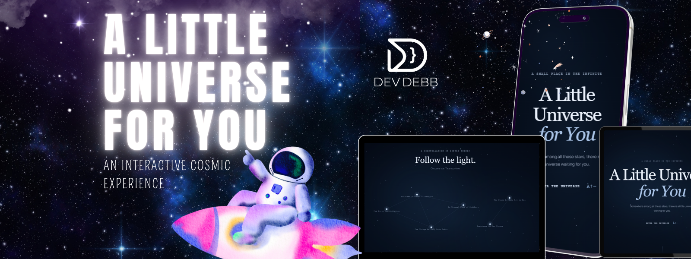

# A Little Universe for You

  <em>An Interactive Cosmic Experience</em>

  A journey through stars, memories, and the beauty of the universe.

  <a href="https://a-little-universe-for-you-gray.vercel.app/">
    <strong>Explore the Live Experience</strong>
  </a>

---

## About the Project

**A Little Universe for You** is an interactive web experience inspired by the beauty, mystery, and immensity of the cosmos.

The project combines a cosmic atmosphere, visual storytelling, animations, and interactive elements to create a memorable digital experience.

Inspired by the idea that even the vastest universe can hold something meaningful, this experience invites visitors to explore a small universe filled with stars, discoveries, and personal messages.

## Live Demo

Experience the project online:

**[A Little Universe for You — Live Website](https://a-little-universe-for-you-gray.vercel.app/)**

## Features

- **Cosmic Atmosphere:** A star-filled environment inspired by deep space.
- **Interactive Elements:** Discover different parts of the experience through user interactions.
- **Visual Storytelling:** An immersive journey built around exploration and discovery.
- **Animated Effects:** Atmospheric animations and glowing visual elements.
- **Meaningful Messages:** A creative concept that connects technology with personal expression.
- **Responsive Design:** Designed to adapt to different screen sizes.

*Note: Features and functionality may evolve as development progresses.*

## Technologies

- HTML5
- CSS3
- JavaScript
- Vite
- Vercel

## Project Goals

- Explore creative possibilities in front-end development.
- Build visually engaging and interactive web experiences.
- Practice animations, transitions, and responsive design.
- Combine technology with creative storytelling.
- Create a distinctive digital experience inspired by the universe.

## Experience Concept

The experience is inspired by the idea of exploring a small universe.

Stars become points of discovery, interactions invite visitors to explore new details, and the visual atmosphere transforms the website into a journey through a digital cosmos.

Every element contributes to the experience, blending the mystery of space with a meaningful and immersive concept.

## Project Status

**In Development**

This project is a work in progress. Its design, features, animations, and interactive elements may evolve throughout development.

## License

No license has been specified for this project yet.

---

  <em>Every star has a story. Every universe holds a little wonder.</em>

